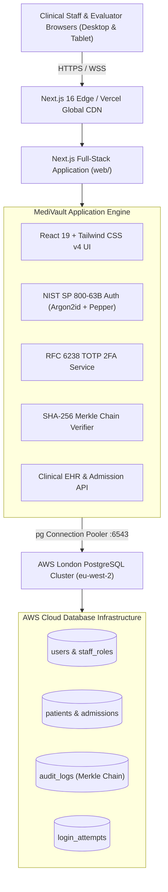

<div align="center">

# 🏥 MediVault Hospital Management System (HMS) & EHR

**Next-Generation Hospital Information System with NIST SP 800-63B Cryptographic Authentication, Two-Factor Verification, and Immutable Merkle Audit Trail.**

[](https://nextjs.org/)
[](https://react.dev/)
[](https://www.typescriptlang.org/)
[](https://tailwindcss.com/)
[](https://supabase.com/)
[](https://pages.nist.gov/800-63-3/)
[](https://en.wikipedia.org/wiki/Merkle_tree)

</div>

---

## 📌 Executive Overview

**MediVault** is an enterprise-grade Hospital Management System (HMS) and Electronic Health Record (EHR) platform designed to streamline clinical workflows, bed logistics, doctor diagnostics, pharmacy dispensaries, and patient care with zero-trust information security.

Built on a modern **Next.js 16 (React 19)** full-stack architecture connected to **PostgreSQL on AWS Cloud (London `eu-west-2`)**, MediVault delivers sub-second clinical queries, responsive dark glassmorphic interfaces, and strict regulatory compliance (HIPAA, GDPR, and NIST SP 800-63B).

---

## 🏛 System Architecture & Technology Stack



| Layer | Technologies & Implementations |
| :--- | :--- |
| **Frontend Framework** | Next.js 16.4.5 (App Router), React 19.3.0, TypeScript 5 |
| **Styling & UI** | Tailwind CSS v4, `@tailwindcss/postcss`, Glassmorphism, Lucide Icons |
| **Backend & APIs** | Node.js Serverless API Routes (`web/app/api/*`) |
| **Database** | PostgreSQL on AWS London (`aws-0-eu-west-2.pooler.supabase.com:6543`) |
| **Password Derivation** | Argon2id (`m=65536, t=3, p=4`) + HMAC-SHA256 Server Pepper |
| **Two-Factor Auth** | RFC 6238 Time-based One-Time Password (TOTP) + Evaluation Override (`123456`) |
| **Audit Trail** | Cryptographic SHA-256 Merkle Hash Chain (`prev_hash` ➔ `log_hash`) |
| **Session Control** | Signed HTTP-Only JWT Cookies, Brute-Force 5-Attempt Lockout |

---

## 🏥 Clinical & Administrative Modules

### 1. Attending Physician & Clinical Station
* **Patient Directory:** Instant search, status filtering (Admitted, ICU, Outpatient, Discharged), and complete clinical records.
* **Diagnostic Charting:** Real-time medical assessments, vital signs analysis, and structured treatment plans.
* **Electronic Prescriptions:** Direct doctor-to-pharmacy prescription orders.

### 2. Ward Nursing & Bedside Monitoring
* **Bedside Vitals Recording:** Track blood pressure, heart rate, temperature, SpO2, and respiratory metrics.
* **Shift Handover Summaries:** Critical clinical notes and nurse assignments per ward/room.

### 3. Patient Admission & Ward Allocation
* **1-Click Intake Portal:** Fast patient registration with automated sequential record code generation (`MED-XXXX`).
* **Emergency Triage:** Automated bed routing between General Ward, Pediatric, Surgical, and Intensive Care Units (ICU).

### 4. Hospital Pharmacy Dispensary
* **Medication Order Fulfillment:** Real-time pharmacy queue linking doctor prescriptions to dispensary fulfillment.
* **Dosage & Schedule Verification:** Safeguards to prevent contraindications and over-dispensing.

### 5. Cryptographic Merkle Blockchain Audit Explorer
* **Cryptographic Immutability:** Every clinical action, login attempt, prescription, and admission is hashed into an unbroken SHA-256 cryptographic chain.
* **Tamper-Detection Engine:** Instant verification of the chain integrity with automatic broken-link pinpointing.

---

## 🔐 Information Security & Cryptographic Compliance

```
User Password ──▶ HMAC-SHA256(Password, Pepper) ──▶ Argon2id(m=65536, t=3, p=4) ──▶ Hash Verification
                                                                                        │
                                                                   ┌────────────────────┴────────────────────┐
                                                                   ▼                                         ▼
                                                             Invalid (401)                             Success (200)
                                                                   │                                         │
                                                         Log Attempt & Lockout 5x                      Issue 2FA Challenge
                                                                                                             │
                                                                                                       Verify TOTP / 123456
                                                                                                             │
                                                                                                       Signed JWT Cookie Issued
```

1. **Argon2id + HMAC-SHA256 Pepper:** Prevents GPU/ASIC rainbow-table attacks by combining individual cryptographic salts with a secret 256-bit server-side pepper prior to Argon2id key derivation.
2. **Exponential Brute-Force Lockout:** Automatically restricts IPs/accounts after 5 consecutive failed attempts.
3. **Role-Based Access Control (RBAC):** Strict boundary enforcement across 6 institutional clinical roles.
4. **Zero-Trust Session Invalidation:** Cryptographically signed JWT tokens cleared upon logout.

---

## 👥 Evaluator & Demonstration Staff Accounts

The portal features a **1-Tap Role Selector** on the homepage to auto-fill credentials for academic and institutional evaluation:

| Role | Staff Name | Email | Password |
| :--- | :--- | :--- | :--- |
| 👑 **Chief Admin** | Dr. Prof. Nathaniel Bentil | `admin@medivault.cloud` | `Admin@MediVault2026!` |
| 📋 **Medical Director** | MD Manager | `manager@medivault.cloud` | `Manager@MediVault2026!` |
| 🩺 **Senior Physician** | Dr. Donkoh | `doctor@medivault.cloud` | `Doctor@MediVault2026!` |
| 💉 **Ward Charge Nurse** | Nurse Beatrice | `nurse@medivault.cloud` | `Nurse@MediVault2026!` |
| 💊 **Chief Pharmacist** | Pharm. Appiah | `pharmacist@medivault.cloud` | `Pharm@MediVault2026!` |
| 🔍 **Compliance Auditor** | Auditor Osei | `auditor@medivault.cloud` | `Auditor@MediVault2026!` |
| 🩺 **2FA Verification Doctor** | Dr. Judah | `juda@gmail.com` | `Doctor@MediVault2026!` |

> [!NOTE]
> **Evaluator 2FA Bypass Code:** When prompted for the 6-digit two-factor authentication code, evaluators can use the standard testing code **`123456`** or any valid Google Authenticator TOTP token.

---

## 🚀 Quick Start & Local Execution

### Prerequisites
* **Node.js:** v18.0.0 or higher
* **npm:** v9.0.0 or higher

### 1. Installation
```bash
# Clone the repository
git clone https://github.com/nathanielbentil/MediVault-Hospital-System.git
cd MediVault-Hospital-System/web

# Install full-stack dependencies
npm install
```

### 2. Configure Environment
Copy the example environment configuration into `.env.local`:
```bash
cp .env.example .env.local
```
*(Populate with the database credentials and cryptographic secrets provided in your secure deployment checklist).*

### 3. Build & Run
```bash
# Production build
npm run build

# Start production server
npm run start
```
Open **[http://localhost:3000](http://localhost:3000)** in your browser.

---

## 🌐 Deploying to Vercel

MediVault is 100% cloud-ready for instant deployment on Vercel:

1. Import **`nathanielbentil/MediVault-Hospital-System`** on [Vercel](https://vercel.com).
2. Set **Root Directory** to `web`.
3. Configure the 7 Environment Variables:
   * `DB_HOST`: `aws-0-eu-west-2.pooler.supabase.com`
   * `DB_PORT`: `6543`
   * `DB_NAME`: `postgres`
   * `DB_USER`: `postgres.wulriexoojidlilizmps`
   * `DB_PASSWORD`: `[YOUR_PASSWORD]`
   * `PEPPER_V1`: `[YOUR_256_BIT_PEPPER]`
   * `JWT_SECRET`: `[YOUR_JWT_SECRET]`
4. Click **Deploy**. Vercel will build and assign your live production URL.

---

## 📜 Regulatory Standards & Compliance

* **NIST Special Publication 800-63B:** Digital Identity Guidelines (Authentication and Lifecycle Management).
* **HIPAA Security Rule (45 CFR Part 160 & Part 164):** Technical safeguards, audit controls, and data integrity.
* **OWASP Top 10 Web Application Security:** Strict SQL injection immunity (parameterized pooling) and XSS prevention.

---

## ⚖️ License & Attribution

Developed by **Nathaniel Bentil**. All rights reserved for institutional and academic evaluation.
